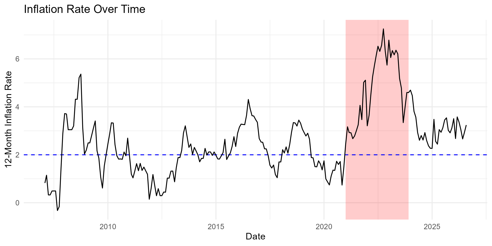
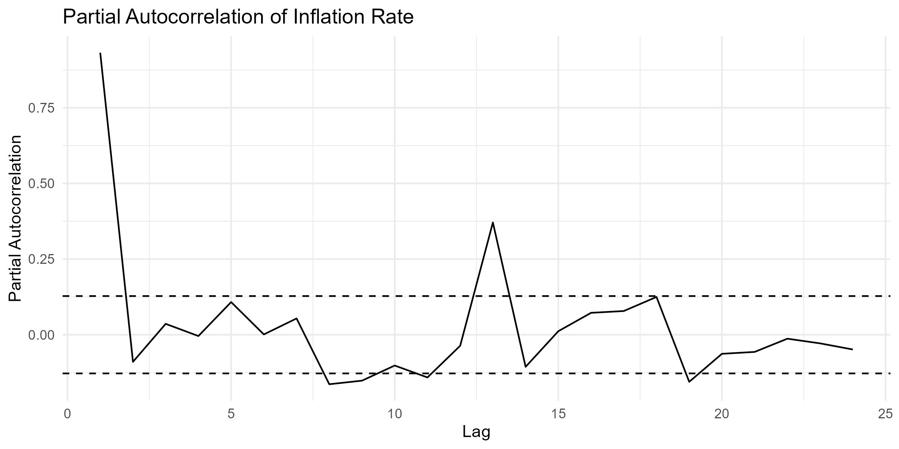
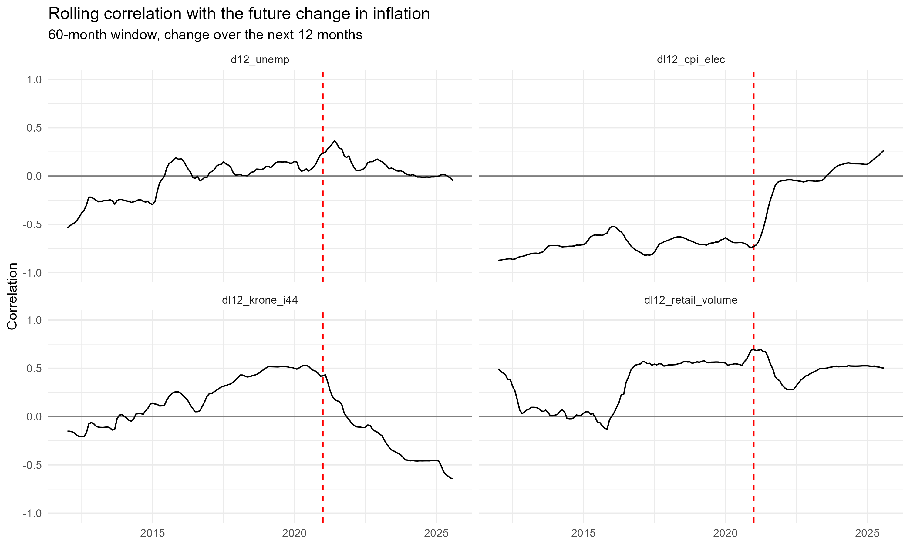
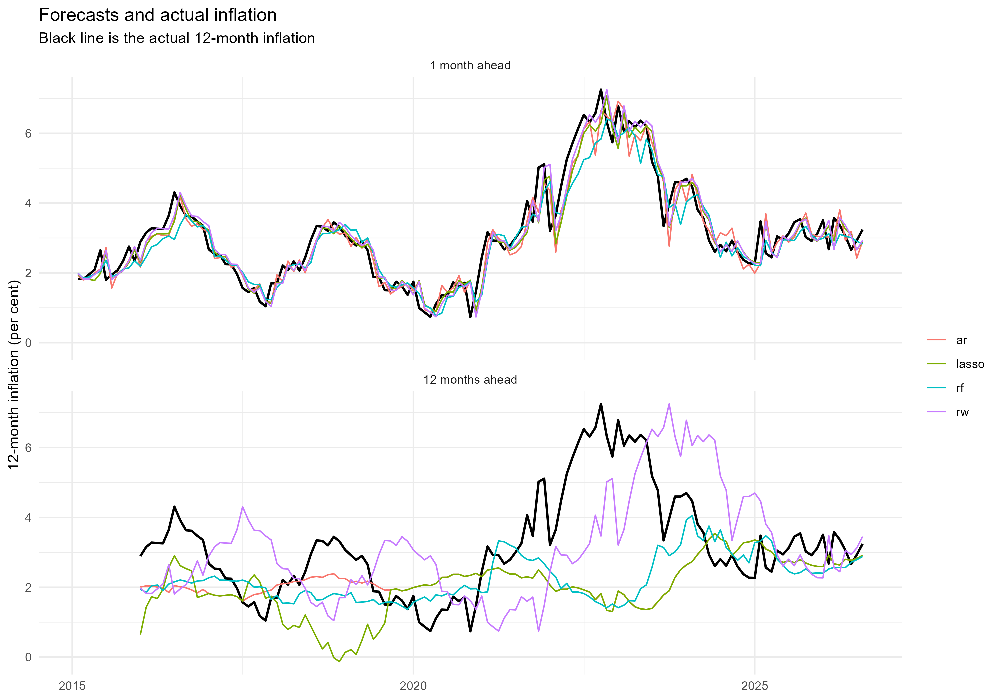

<!-- NOTE FOR THE TEAM
Still to do before submitting:
1. Truls: replace XXXX in the header with your candidate number.
2. Truls: add your sentences linking our results to the literature in the conclusion, after "simple models are hard to beat".
3. Delete this comment.
-->

```{r}
#| label: setup
library(tidyverse)
library(knitr)

# Result tables saved by Modelling.R
rmse = read_csv("../results/table_rmse.csv", show_col_types=FALSE)
mae = read_csv("../results/table_mae.csv", show_col_types=FALSE)
rmse_dm = read_csv("../results/table_rmse_dm.csv", col_types=cols(.default=col_character())) |>
  mutate(h=as.integer(h))
selection = read_csv("../results/lasso_selection_share.csv", show_col_types=FALSE)
rmse_core = read_csv("../results/table_rmse_core.csv", show_col_types=FALSE)
rmse_rolling = read_csv("../results/table_rmse_rolling.csv", show_col_types=FALSE)

period_order = c("2015-2020", "2021-2026", "2015-2026")
model_cols = c("rw", "ols", "lasso", "ridge", "enet", "rf")
model_names = c("RW", "OLS", "LASSO", "Ridge", "EN", "RF")
```

# Introduction and objective

For most of the 2010s, forecasting Norwegian inflation looked easy. The 12-month rate moved mostly between 1 and 4 per cent and never stayed far from Norges Bank's target for long. Then it climbed. By October 2022 it had passed 7 per cent, more than three times the 2 per cent target, and it stayed above 5 per cent until the summer of 2023. A model trained on the calm years had almost nothing in its data that looked like what was coming.

That makes Norway a hard test for a claim that has become popular. The older view of inflation forecasting is that simple models are very hard to beat: a random walk or a short autoregression tends to match models built on economic theory [@atkeson2001; @stock2007]. The newer view comes from machine learning. Using more than a hundred US series from the FRED-MD database [@mccracken2016], @medeiros2021 find that machine learning methods, and random forests in particular, clearly improve on these benchmarks. But their setting is data rich. We have about twenty years of monthly data and a dozen relevant series, and it is not obvious that the result survives the move.

We ask three questions. Can machine learning methods improve out-of-sample forecasts of Norwegian inflation compared with simple linear benchmarks? Did the ranking of the models change when inflation surged after 2021? And which predictors does LASSO actually select, and does the selection change over time?

Most of the work in answering them is programming. The data come from four public APIs, every series has to enter on the date it was actually published, and seven models have to be re-estimated every month for almost twelve years without ever seeing the future. We describe how we built that pipeline, where it can quietly go wrong, and how we checked it. The answer to the first question turns out to be no. The second shows that even the ranking of the simple models depends on the period, and the third explains why the machine learning models gain so little.

# Data and preparation

## From four APIs to one table

All series are monthly and come straight from the providers' APIs, so one script rebuilds the whole dataset. @tbl-data lists them. Consumer prices, unemployment, household credit and retail sales come from Statistics Norway [@ssb], exchange rates and the policy rate from Norges Bank [@norgesbank], interest rates, oil prices and US prices from FRED [@fred], and euro area inflation from Eurostat [@eurostat], using the `eurostat` package [@eurostat-r]. Each provider has its own format: Norges Bank serves semicolon-separated files, Statistics Norway writes months as `2005M01`, and FRED marks missing values with a dot. We wrote one small download function per provider that always returns the same two columns, a date and a value, so that all series can be joined by date in a single step.

The target is headline 12-month inflation, measured as a log change:

$$
\pi_t = 100 \, (\ln P_t - \ln P_{t-12})
$$ {#eq-target}

where $P_t$ is the consumer price index. As a first check on the pipeline, we compared it with the 12-month rate that Statistics Norway publishes. Once that rate is put on the same log scale, the two never differ by more than 0.05 percentage points.

Two choices at this stage decide whether the later forecasts are honest and stable. The first is about timing. Several series are published a month after the CPI, so on the day we make a forecast we only know last month's unemployment rate, credit growth, retail sales, US CPI and euro area inflation. Using the current month's value would give the models information that no forecaster had. We therefore move these series one month later before the join, so each value sits in the row where it was actually available. The second is about trends. Most predictors trend or wander, and a model fitted on such a series learns the trend instead of the relationship. Following common practice for macroeconomic data [@mccracken2016], prices and indexes enter as 12-month log changes and interest rates as 12-month differences. ADF and KPSS tests from the `tseries` package [@tseries] confirm that most of the transformed series are stationary. The inflation rates do not pass, which reflects the shift in level after 2021, so we keep them.

One missing US CPI value (October 2025) is filled with the geometric midpoint of its neighbours. After the 12-month changes, the sample runs from February 2007 to August 2026: 235 months with no missing values.

| Series (name in the code) | Source | Used as |
|:------------------------------------------------------|:----------------|:---------------------------|
| Consumer price index, the target (`inflation_12m`) | SSB 14706 | 12-month log change |
| Import-weighted krone index I-44 (`dl12_krone_i44`) | Norges Bank | 12-month log change |
| NOK per euro and per dollar (`dl12_eur_nok`, `dl12_usd_nok`) | Norges Bank | 12-month log change |
| Policy rate (`d12_policy_rate`) | Norges Bank | 12-month change |
| 3-month interbank rate (`d12_rate_3m`) | OECD via FRED | 12-month change |
| 10-year government bond yield (`d12_yield_10y`) | OECD via FRED | 12-month change |
| 10-year yield minus 3-month rate (`term_spread`) | Computed | Level |
| Unemployment rate, seasonally adjusted (`d12_unemp`) | SSB 13760 | 12-month change, lagged |
| CPI for electricity (`dl12_cpi_elec`) | SSB 14700 | 12-month log change |
| Household credit growth (`credit_growth`) | SSB 11599 | Level, lagged |
| Retail sales volume, seasonally adjusted (`dl12_retail_volume`) | SSB 07129 | 12-month log change, lagged |
| Brent crude oil price in USD (`dl12_brent_usd`) | FRED | 12-month log change |
| US consumer price index (`dl12_us_cpi`) | FRED | 12-month log change, lagged |
| Euro area HICP, 12-month rate (`hicp_ea`) | Eurostat | Level, lagged |

: The series in the dataset. All rows below the target are predictors, 14 in total. "Lagged" marks series published a month after the CPI, which enter one month later. {#tbl-data}

## Three clues in the data

Before fitting any model we looked at the data, and three things stood out. Each of them comes back in the results.

The first is that the surge is a regime of its own. @fig-inflation shows the target. Inflation averaged 1.9 per cent in 2007–2014 and 2.3 per cent in 2015–2020, then 4.0 per cent from 2021, with a peak of 7.3 per cent in October 2022. In 14 of the 68 months since January 2021, it was above its highest value before 2021 (5.4 per cent). A structural break test on the mean [@bai2003; @strucchange] places breaks in 2011, 2013, late 2021 and early 2024.

{#fig-inflation width=76%}

The second is persistence, with a twist. The correlation between inflation and its own value a month earlier is 0.94, and the autocorrelation stays significant for about 18 months. But the partial autocorrelation in @fig-pacf has a second spike at lag 13. This is the base effect: next month's 12-month rate drops the price change from 12 months back, so the month that is about to leave the window says something about where the rate is heading.

{#fig-pacf width=62%}

The third is that the predictors cannot be trusted for long. To avoid choosing predictors with knowledge of the test period, we made every modelling decision on 2007–2014 only, the window the first forecasts are trained on. There, several predictors are clearly related to the future change in inflation, which is the part a random walk cannot predict: electricity prices have a correlation of −0.85 with the change over the next 12 months, unemployment −0.52 and retail sales 0.46. These relationships do not last. @fig-rolling follows four of them through 60-month rolling windows. The electricity correlation sits around −0.7 for a decade and then breaks within a year of 2021, ending positive. The krone correlation drifts from zero to 0.5 and then falls to −0.64. Only retail sales is fairly stable, and only after 2016. A model that learns these relationships before 2021 carries the wrong ones into the surge.

{#fig-rolling width=80%}

# Methods

## Forecasting design

We use direct forecasts. For each horizon $h \in \{1, 3, 6, 12\}$ a separate model predicts inflation $h$ months ahead from what is known today:

$$
\pi_{t+h} = f_h(\pi_t, \pi_{t-1}, \ldots, \pi_{t-12}, x_t) + \varepsilon_{t+h}
$$ {#eq-direct}

where $x_t$ holds the 14 predictors. With the 13 lags of inflation, this gives 27 features.

The exercise is a pseudo out-of-sample one: the models are re-estimated every month in an expanding window, and each forecast uses only data from before its date. The first forecast is made in January 2015, and the training data always start in February 2007. This is where a pipeline most easily cheats without anyone noticing. A training row dated $t$ has a target $h$ months later, and at forecast date $T$ that target is only known if $t \le T - h$. So the training set has to stop $h$ months before the forecast date, not at it:

```{r}
#| label: leakage-rule
#| echo: true
#| eval: false
train = ml_dataset |> filter(date <= origin %m-% months(h))
```

With a forecast date in January 2015, this leaves 95 training months at $h = 1$ and 84 at $h = 12$. Forecasts are made as long as the actual value is in the data, which gives 139, 137, 134 and 128 forecasts at the four horizons, 538 in total.

In the code, every model is a function with the same three arguments: the training rows, the name of the target column and the row to forecast from. It returns one number. A second function builds the training rows for one forecast date and horizon and calls the models, and mapping it over all 538 combinations gives one table of forecasts, which is saved to a file. The evaluation and this report only read those files.

## Models

**Benchmarks.** The random walk (RW) forecasts that inflation stays where it is today. The autoregressive model (AR) regresses $\pi_{t+h}$ on $\pi_t, \ldots, \pi_{t-p+1}$, with the number of lags $p$ between 1 and 13 chosen by BIC within each training window. AR is the reference model in the evaluation. The OLS model uses the same lags as AR plus three classic predictors: the change in unemployment, the krone and the policy rate. Because it shares $p$ with AR, the difference between the two is exactly the contribution of those three predictors.

**Regularised regressions.** LASSO [@tibshirani1996], ridge [@hoerl1970] and elastic net [@zou2005] use all 27 features and shrink the coefficients towards zero. With the `glmnet` package [@glmnet] they solve

$$
\min_{\beta_0, \beta} \; \frac{1}{2n} \sum_{t} \left(\pi_{t+h} - \beta_0 - z_t'\beta\right)^2 + \lambda \sum_{j} w_j \left[\alpha |\beta_j| + \tfrac{1-\alpha}{2} \beta_j^2\right]
$$ {#eq-glmnet}

with $\alpha = 1$ for LASSO, $\alpha = 0$ for ridge and $\alpha = 0.5$ for elastic net. The features are standardised within each training window, so nothing from the test period leaks in through the scaling. The penalty $\lambda$ is chosen by cross-validation on five consecutive blocks of the training window. Randomly drawn folds would mix past and future months, and neighbouring rows share most of their target months.

Our first version penalised all 27 features equally ($w_j = 1$), and it failed in an instructive way. At $h = 6$ and $h = 12$, cross-validation chose the largest penalty in most windows, which sets every coefficient to zero, including the one on today's inflation. In 77 of 134 forecasts at $h = 6$ and 97 of 128 at $h = 12$, all three models collapsed to the same forecast: the average of the training data. The code ran without any error, and we only saw the problem because the forecasts were suspiciously flat. Each block of the training window covers a different regime, so cross-validation found that nothing beat the mean. We therefore set $w_j = 0$ for $\pi_t$. Today's inflation is then never shrunk, the simplest possible model is close to an AR(1), and the penalty only decides whether the other lags and the predictors add something on top of persistence. This brought the RMSE of LASSO relative to AR at $h = 6$ down from 1.40 to 1.03. All results below use this version.

**Random forest.** The random forest [@breiman2001] averages 500 regression trees, each grown on a bootstrap sample with 9 of the 27 features tried at every split and a minimum leaf size of 5, using the `ranger` implementation [@ranger] with a fixed seed. The usual tuning signal, the out-of-bag error, is unreliable here for the same reason random folds are, so these settings stay fixed in every window. One property matters later: a forest cannot forecast above the highest target it has seen in training.

## Evaluation

We measure accuracy with the root mean squared error (RMSE) and the mean absolute error (MAE), both relative to AR, so a ratio below 1 means the model beats AR. Results are reported for the full period and split by the month being forecast into 2015–2020 and 2021–2026. To test whether a model is significantly better or worse than AR, we use the Diebold–Mariano test [@diebold1995] on the squared errors, with the small sample correction of @harvey1997, as implemented in the `forecast` package [@forecast].

# Results and evaluation

## Do the machine learning models beat the benchmarks?

No. @tbl-rmse gives the main results. Over the full period, no machine learning model beats AR at any horizon, with one exception: the random forest at 12 months, where the gain is small and not significant. LASSO, ridge and elastic net finish 2 to 9 per cent behind AR. The random forest does worst where forecasting should be easiest, 13 per cent behind at one month. And every star in the table marks a model that does worse than AR: over the full period, OLS at 3 and 6 months and the random forest at 6.

```{r}
#| label: tbl-rmse
#| tbl-cap: "RMSE relative to AR, by the period being forecast and horizon $h$ in months. The AR column gives the RMSE of AR itself in percentage points. Values below 1 mean the model beats AR. Stars mark a significant Diebold–Mariano test against AR: one star for the 10 per cent level, two for 5 per cent and three for 1 per cent."
rmse_dm |>
  left_join(rmse |> select(period, h, ar), by=c("period", "h")) |>
  mutate(period=factor(period, levels=period_order), ar=sprintf("%.2f", ar)) |>
  arrange(period, h) |>
  select(period, h, ar, all_of(model_cols)) |>
  kable(col.names=c("Period", "h", "AR (RMSE)", model_names), align="llrrrrrrr")
```

The one-month horizon shows why AR is so hard to beat. Next month's inflation is almost a straight line through today's, and every model with a lag of inflation has that line. The random forest is the exception, because a tree can only approximate a straight line with steps, and it loses accuracy doing so. The regularised regressions come closest to a real gain, with an RMSE 1 to 2 per cent below AR at one month in 2015–2020 and an MAE 6 to 7 per cent below. With 71 forecasts, that is too small to be significant.

## Did the ranking change after 2021?

It did, and sharply. In 2015–2020, AR is the best model at every horizon beyond one month (@tbl-rmse), and the random walk is 52 per cent worse at 12 months, a significant difference. Inflation kept returning to about 2 per cent, so AR's pull towards the mean was the right bet. From 2021 the order flips. The random walk becomes the most accurate model at 3, 6 and 12 months, with RMSE ratios of 0.94, 0.85 and 0.82, while the regularised regressions sit almost exactly level with AR at 6 and 12 months. Measured by MAE the conclusions are similar, although the random walk's advantage in the surge is smaller (@tbl-mae in the appendix).

@fig-paths shows what happened. One month ahead, every model follows inflation closely. Twelve months ahead, none of them saw the surge coming: AR, LASSO and the random forest all forecast well below 4 per cent for 2022, when inflation was above 6. The random walk did not anticipate it either, since it simply repeats the value from a year earlier. But once inflation was high it kept forecasting high values, and that was less wrong than forecasting 2 per cent. The random forest moved up to about 3 per cent already in 2021 and again from 2023, ahead of LASSO, which explains its small edge at 12 months. It could not go above its training maximum and stayed far below the peak.

{#fig-paths width=80%}

## What does LASSO select?

The first two answers leave a puzzle. Why do models with 14 extra predictors do no better than a model with none? @fig-lasso shows what LASSO does with them, as the sign of every coefficient at every forecast date. At 1, 3 and 6 months the picture is mostly grey. No predictor is selected in more than 14 per cent of the windows at one month, and at 6 months the predictors are practically never used (@tbl-selection in the appendix). Cross-validation keeps reaching the same verdict: the predictors add nothing reliable on top of today's inflation. LASSO cannot beat AR because, most of the time, it is one.

{#fig-lasso width=90%}

The one lag it does keep is revealing. Next to today's inflation, the most frequent choice is lag 10 at $h = 1$ (66 per cent of windows), lag 9 at $h = 3$ (71 per cent) and lag 6 at $h = 6$, always with a negative sign. These are the months whose price changes are about to leave the 12-month window, roughly $12 - h$ months back. Nobody told the model about the base effect. It found it anyway, in the same place as the spike in @fig-pacf.

At 12 months the picture is different and less flattering. Between 2015 and 2018, LASSO kept 10 to 12 of the 14 predictors and up to 12 lags, with only 84 to 127 training months. Several signs go against economic intuition: rising unemployment and a rising policy rate both predict higher inflation. This dense model is behind the poor LASSO forecasts made in 2017 and 2018, which put inflation close to zero for 2018–2019 while actual inflation was around 3 per cent, and behind its RMSE of 1.63 relative to AR in 2015–2020. From late 2018 LASSO keeps only today's inflation.

The coefficient on today's inflation is worth a look as well. At 12 months it is negative from 2018 to 2022: high inflation today predicted lower inflation in a year, which is mean reversion in a 2 per cent regime. During the surge this pushed the LASSO forecast down while inflation was rising, and the sign only turned positive in 2023, once surge months had entered the training data. After 2021, every predictor is selected less often than before. This is the third clue from the data coming back: once the relationships in @fig-rolling broke, cross-validation stopped trusting them.

## Checks and robustness

Three checks give us confidence in the pipeline. We first ran the benchmarks by hand for a single forecast date (January 2015, $h = 12$), and the full loop reproduces those numbers exactly. The random forest never forecasts above the highest target in its training window (0 of 538 forecasts). And with fixed cross-validation blocks and a fixed seed, a rerun gives identical forecasts.

We also ran the whole exercise twice more, first with core inflation (CPI-ATE) as the target (@tbl-core). The regularised regressions are again never more than 2 per cent ahead of AR and up to 15 per cent behind, and the random forest is about 60 per cent worse at one and three months after 2021, when core inflation spent 23 months above its earlier maximum. One result differs: the small OLS model is 4 to 15 per cent more accurate than AR at every horizon and in both periods. The second run keeps only the last 96 months in a rolling window (@tbl-rolling). Forgetting old data does not help: over the full period AR itself becomes 1 to 13 per cent less accurate, and no machine learning model beats the original AR by more than 3 per cent.

# Conclusion

Machine learning does not improve on a simple autoregressive model for Norwegian inflation: no challenger beats AR significantly at any horizon. The ranking did change after 2021, but not in favour of machine learning. Before the surge, mean reversion paid off and AR was best. During it, persistence paid off and the random walk was best, and no model anticipated the surge itself. And what LASSO selects explains both results. With about twenty years of monthly data and relationships that keep shifting, the best a regularised model can do is to become an autoregression, and it does, rediscovering the base effect on the way. When it trusts many predictors, as at the 12-month horizon before 2019, it overfits and gets worse. Core inflation points the same way: the only model that is always ahead of AR there is the small OLS model. In this sample, the older view from the introduction holds: simple models are hard to beat.

These conclusions come with limitations. With 60 to 70 forecasts per period, the Diebold–Mariano test has little power, so "not significant" means we cannot tell the models apart, not that they are equal. We also use the latest published data and not the vintages available at each forecast date, so revised series such as unemployment are slightly better than what a real forecaster had.

# Use of AI tools {.unnumbered}

We used Claude (Anthropic) in two ways. The first was code review: after writing each part of the pipeline, we asked it to read our code and point out errors. This was most useful for bugs that do not stop the code from running. It found a forecasting function that silently used a variable left over from an earlier test, so every forecast was compared with the same actual value, and it noticed that our first regularised regressions had collapsed to the training mean at long horizons. The second was as a tutor, for the parts of the project that needed knowledge we did not have yet. There it explained the methods and the R tools with small, generic examples, and we then wrote the final code ourselves. We generated many visualization for this project, and we used LLM to prioritize which one can be helpful for this report. What we learned is that the tool helps most as a second reader of work we understand ourselves, and least where we cannot check it, so we treated its answers as proposals and tested them against our own output. 

# References {.unnumbered}

::: {#refs}
:::

# Appendix {.unnumbered}

```{r}
#| label: tbl-mae
#| tbl-cap: "MAE relative to AR. The AR column gives the MAE of AR itself in percentage points."
mae |>
  mutate(period=factor(period, levels=period_order)) |>
  arrange(period, h) |>
  mutate(across(c(ar, all_of(model_cols)), \(x) sprintf("%.2f", x))) |>
  select(period, h, ar, all_of(model_cols)) |>
  kable(col.names=c("Period", "h", "AR (MAE)", model_names), align="llrrrrrrr")
```

```{r}
#| label: tbl-selection
#| tbl-cap: "Share of forecast dates where LASSO selects each variable, by horizon."
selection |>
  mutate(across(starts_with("h"), \(x) sprintf("%.2f", x))) |>
  kable(col.names=c("Variable", "h = 1", "h = 3", "h = 6", "h = 12"), align="lrrrr")
```

```{r}
#| label: tbl-core
#| tbl-cap: "Robustness check with core inflation (CPI-ATE) as the target: RMSE relative to AR. The AR column gives the RMSE of AR itself in percentage points. The lags of core inflation need one more year of history, so this sample starts in February 2008."
rmse_core |>
  mutate(period=factor(period, levels=period_order)) |>
  arrange(period, h) |>
  mutate(across(c(ar, all_of(model_cols)), \(x) sprintf("%.2f", x))) |>
  select(period, h, ar, all_of(model_cols)) |>
  kable(col.names=c("Period", "h", "AR (RMSE)", model_names), align="llrrrrrrr")
```

```{r}
#| label: tbl-rolling
#| tbl-cap: "Robustness check with a rolling window of 96 months: RMSE of each model relative to the AR model with the expanding window, the reference in the main table. The AR column shows how AR itself changes when it only sees the last 96 months."
rmse_rolling |>
  mutate(period=factor(period, levels=period_order)) |>
  arrange(period, h) |>
  mutate(across(c(ar, all_of(model_cols)), \(x) sprintf("%.2f", x))) |>
  select(period, h, ar, all_of(model_cols)) |>
  kable(col.names=c("Period", "h", "AR", model_names), align="llrrrrrrr")
```

## Code {.unnumbered}

The project folder has one folder for each part:

- `code/` holds three R scripts, run in this order from the project folder in one R session, since the later scripts use the datasets built by the first. `Preprocessing.R` downloads all series from the APIs, applies the publication lags and transformations, and builds `dataset` (for the analysis) and `ml_dataset` (with the 13 inflation lags and the four targets). `EDA.R` produces the descriptive figures, the stationarity tests, the correlation analysis, the structural break test and the rolling correlations. `Modelling.R` runs the expanding-window forecasts, computes the evaluation tables, refits LASSO in every window to record the selected variables, and repeats the forecasts for core inflation and with a rolling window.
- `notebooks/` holds a notebook version of each script, with the same code and its output.
- `pdfs/` holds the rendered notebooks as PDF files. They show every figure and table, including those that are not in this report.
- `report/` holds this report and its references.

The scripts save their figures in `images/` and their forecasts and tables in `results/`. The forecasting loops take a few minutes in total. This report only reads the saved files, so it renders in seconds. The analysis uses R [@R-base] with the tidyverse [@tidyverse], `slider` [@slider] for rolling windows, `glmnet`, `ranger` and `forecast`.
